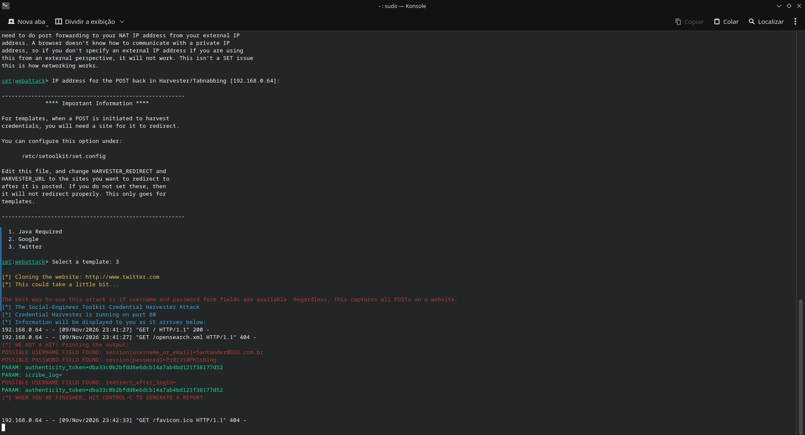

# 🎣 Simulação de Phishing com Setoolkit (SET) — Desafio Cybersecurity Santander/DIO

Projeto desenvolvido como desafio do bootcamp de Cibersegurança **Santander + DIO**, com o objetivo de aplicar na prática os conceitos de *Social Engineering* e *Credential Harvesting* utilizando o **Social-Engineer Toolkit (SET)**.

## ⚠️ Aviso Ético e Legal

Este projeto foi desenvolvido **exclusivamente para fins educacionais**, em **ambiente controlado e isolado**, como parte de um desafio de curso de segurança da informação. Nenhum site real de terceiros foi clonado ou atacado — foi utilizado o **template oficial embutido no próprio SET**, sem interação com usuários reais ou sistemas de produção.

A técnica demonstrada aqui (clonagem de página de login para captura de credenciais) é amplamente usada por profissionais de segurança em **testes de phishing autorizados (red team / conscientização de colaboradores)**. Reproduzir esse tipo de ataque contra terceiros sem autorização explícita é **crime previsto em lei** (no Brasil, pode se enquadrar na Lei Carolina Dieckmann, além de outras legislações de proteção de dados). O objetivo deste repositório é puramente demonstrar o entendimento técnico da ameaça, para melhor saber como se defender dela.

## 🎯 Objetivo do Desafio

- Aplicar na prática os conceitos de engenharia social aprendidos no curso
- Utilizar o **Setoolkit (SET)** para simular a captura de credenciais via página falsa
- Documentar o raciocínio técnico e as decisões tomadas durante o processo
- Publicar o projeto no GitHub como peça de portfólio

## 🛠️ Ferramentas e Ambiente

| Item | Detalhe |
|---|---|
| Sistema Operacional | Nobara Linux (baseado em Fedora) |
| Ferramenta principal | [Social-Engineer Toolkit (SET)](https://github.com/trustedsec/social-engineer-toolkit) |
| Linguagem | Python 3 |
| Rede | Ambiente local/isolado (sem exposição externa) |

## 🧩 Metodologia

### 1. Instalação do SET

```bash
sudo dnf install git python3 python3-pip python3-devel gcc make -y
git clone https://github.com/trustedsec/social-engineer-toolkit/ setoolkit
cd setoolkit
pip3 install -r requirements.txt --break-system-packages
sudo python3 setoolkit
```

> Observação técnica: o instalador tradicional (`setup.py install`) apresentou erro de `ModuleNotFoundError: No module named 'setuptools'` no Python 3.14 (versão mais recente usada pelo Nobara). A solução foi executar a ferramenta diretamente via `sudo python3 setoolkit`, que roda sem depender da etapa de instalação via setuptools.

### 2. Navegação no menu do SET

O ataque foi conduzido pelo módulo de **Credential Harvester**, seguindo o caminho:

```
1) Social-Engineering Attacks
 → 2) Website Attack Vectors
   → 3) Credential Harvester Attack Method
     → 1) Web Templates
```

### 3. Escolha do template

Em vez de usar a opção *Site Cloner* (que tenta clonar um site real em tempo real — hoje bloqueada pela maioria dos sites modernos por proteções anti-scraping/JS dinâmico), foi utilizado um dos **templates pré-construídos que já acompanham o SET**, evitando qualquer interação com infraestrutura real de terceiros.

### 4. Execução e captura

Com o servidor rodando localmente na porta 80, a página falsa foi acessada via navegador. Ao preencher o formulário de login simulado, o SET capturou e exibiu em tempo real os campos submetidos (usuário/e-mail e senha), demonstrando como a captura de credenciais funciona do lado do atacante.

## 📸 Resultado



*Print do terminal mostrando o SET capturando os dados submetidos no formulário de login falso em ambiente de teste.*

## 📚 Aprendizados

- Como ferramentas de *Credential Harvesting* funcionam na prática
- Por que sites modernos (JS dinâmico, detecção de bot, headers) dificultam a clonagem direta de páginas reais
- A importância de treinamentos de conscientização contra phishing em empresas
- Diferença entre simulação controlada e ataque real não autorizado

## 🔗 Referências

- [Social-Engineer Toolkit (TrustedSec)](https://github.com/trustedsec/social-engineer-toolkit)
- Curso: Cibersegurança — Santander + DIO

---

*Projeto educacional desenvolvido por [SEU NOME AQUI] como parte do bootcamp Santander + DIO de Cibersegurança.*
